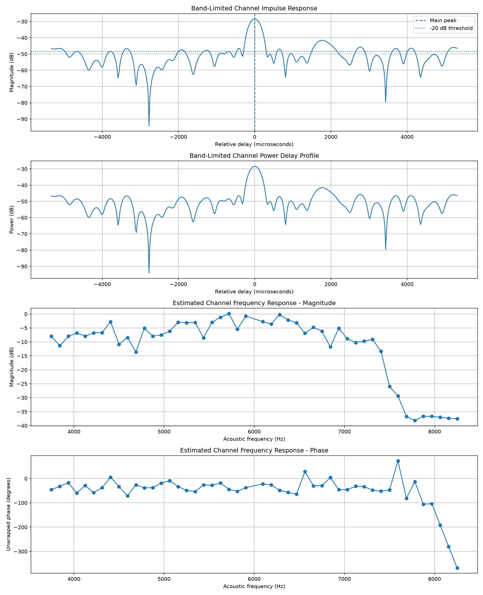
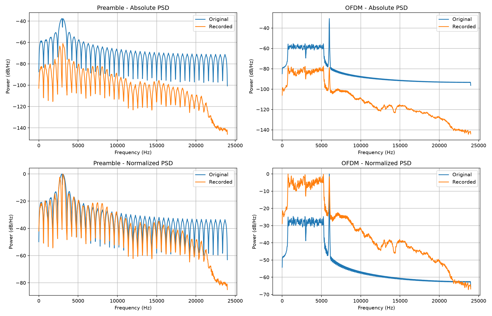
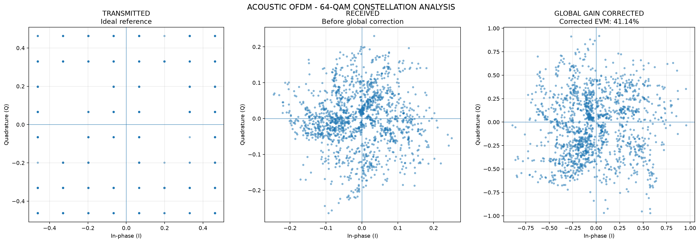
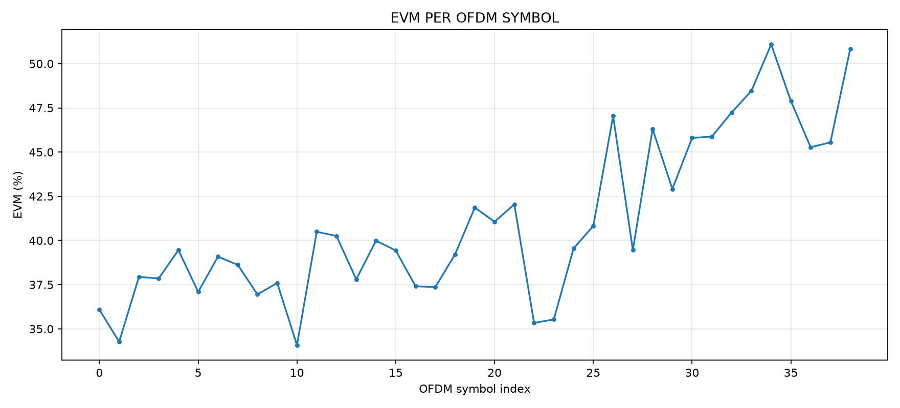

# Acoustic OFDM 64-QAM Modem

A software-defined acoustic communication system implementing an OFDM physical-layer pipeline with 64-QAM modulation, synchronization, channel estimation, frequency-domain equalization, and packet integrity validation.

The project explores how digital wireless communication concepts can be adapted to an acoustic transmission channel using Python, digital signal processing (DSP), and real speaker-to-microphone experiments.

> **Project scope:** This is an experimental acoustic OFDM modem inspired by modern wireless physical-layer architectures. It is not a 3GPP 5G NR implementation or a standards-compliant cellular modem.

---

## 1. Project Overview

The goal of this project is to design and evaluate a digital communication system capable of transmitting text through an acoustic channel.

The transmitter converts text into a framed digital bitstream, maps payload bits to 64-QAM symbols, generates OFDM symbols, and produces an audio waveform.

The receiver processes the received audio, detects the transmission, synchronizes the OFDM frame, estimates the channel, compensates for channel effects, demaps the received constellation, and validates the recovered packet using CRC.

The project was developed incrementally, moving from a controlled digital simulation to experiments involving a physical speaker-to-microphone channel.

### Main capabilities

- Text-to-bitstream encoding and packet construction.
- 64-QAM payload modulation.
- OFDM modulation and demodulation.
- BPSK pilot subcarriers for channel estimation.
- Acoustic preamble and postamble detection.
- Frame synchronization and timing recovery.
- Frequency-domain channel estimation.
- ZF and MMSE equalization experiments.
- 64-QAM constellation and EVM analysis.
- CRC-based packet integrity validation.
- WAV-based signal generation and real audio capture.
- Channel and spectrum diagnostic tools.

---

## 2. System Architecture

The communication chain is divided into transmitter, acoustic channel, and receiver stages.

### Transmitter

1. Input text.
2. UTF-8 text encoding.
3. Packet and frame construction.
4. CRC generation.
5. 64-QAM symbol mapping.
6. Resource grid construction.
7. BPSK pilot insertion.
8. OFDM modulation.
9. Acoustic preamble and postamble insertion.
10. Audio waveform generation.

### Acoustic channel

The generated waveform can be processed as a digital signal or transmitted through physical audio equipment.

The real acoustic scenario introduces effects such as:

- Frequency-dependent attenuation.
- Acoustic reflections.
- Background noise.
- Timing uncertainty.
- Speaker and microphone frequency response.
- Amplitude variation.
- Residual frequency and phase errors.

### Receiver

1. Audio loading or microphone capture.
2. Signal quality analysis.
3. Preamble detection.
4. OFDM frame synchronization.
5. Timing recovery.
6. OFDM demodulation.
7. Resource grid extraction.
8. Pilot-based channel estimation.
9. Frequency-domain equalization.
10. 64-QAM demapping.
11. Header and payload decoding.
12. CRC validation.
13. UTF-8 text recovery.

---

## 3. System Configuration

The following parameters describe the current implementation.

| Parameter | Value |
|---|---:|
| Sample rate | 48,000 Hz |
| Carrier frequency | 6,000 Hz |
| FFT size | 512 |
| Cyclic prefix | 64 samples |
| OFDM symbol length | 576 samples |
| Subcarrier spacing | 93.75 Hz |
| Active subcarriers | 48 |
| Data subcarriers | 40 |
| Pilot subcarriers | 8 |
| Payload modulation | 64-QAM |
| Pilot modulation | BPSK |
| Training OFDM symbols | 2 |

The OFDM symbol duration, including the cyclic prefix, is:

\[
T_{\mathrm{symbol}} = \frac{576}{48000}
= 12\ \mathrm{ms}
\]

The subcarrier spacing is:

\[
\Delta f = \frac{48000}{512}
= 93.75\ \mathrm{Hz}
\]

The payload uses 64-QAM, while BPSK pilot symbols provide known reference values for channel estimation.

---

## 4. Implementation Details

### 4.1 OFDM Modulation

OFDM divides the available frequency spectrum into orthogonal subcarriers.

The transmitter maps data and pilot symbols into a frequency-domain resource grid and applies an inverse FFT to generate the time-domain OFDM waveform.

A cyclic prefix is added to each OFDM symbol to improve robustness against multipath propagation and inter-symbol interference, provided the effective channel delay spread remains within the cyclic prefix duration.

### 4.2 64-QAM Modulation

The payload uses 64-QAM, allowing each modulation symbol to represent six bits.

The receiver applies constellation-based demapping to recover the transmitted bitstream.

The 64-QAM implementation provides a useful experimental basis for studying the relationship between channel quality, constellation distortion, and successful packet decoding.

### 4.3 Pilot-Based Channel Estimation

Known BPSK pilot symbols are inserted into selected OFDM subcarriers.

At the receiver, the known pilot values are used to estimate the channel frequency response.

The estimated channel response provides information about the attenuation and phase variation experienced by the transmitted signal across active subcarriers.

### 4.4 Frequency-Domain Equalization

The project includes experiments comparing two frequency-domain equalization approaches:

- **Zero-Forcing (ZF):** compensates for the estimated channel response.
- **Minimum Mean Square Error (MMSE):** balances channel compensation against noise amplification using an effective noise variance estimate.

The MMSE noise estimate is derived from inactive subcarriers. It should be interpreted as an effective noise and residual-interference estimate, rather than necessarily representing pure acoustic noise.

### 4.5 Synchronization

The receiver uses an acoustic preamble and OFDM training structure to locate and synchronize the transmission.

The synchronization experiments evaluate:

- Preamble correlation.
- OFDM symbol boundary detection.
- Cyclic-prefix correlation.
- Training-symbol correlation.
- Carrier frequency offset estimates.

A postamble is also used to help identify the end of the transmitted frame.

### 4.6 Packet Integrity

CRC checks are used to validate the decoded header and payload.

CRC provides an integrity check; it does not correct corrupted bits.

The current implementation does not include a validated forward error correction (FEC) system.

---

## 5. Experimental Work

The project was developed through several focused experiments before consolidating the main transmitter and receiver pipeline.

### 5.1 Digital End-to-End Validation

The first validation stage uses a generated digital waveform and the software receiver.

This experiment verifies the complete transmitter-to-receiver processing chain under controlled conditions.

**Recorded results:**

| Metric | Result |
|---|---:|
| Input text size | 1,136 bytes |
| Packet size | 1,140 bytes |
| Generated audio samples | 60,176 |
| Sample rate | 48 kHz |
| Preamble correlation | 0.9938 |
| Cyclic-prefix correlation | 0.9814 |
| Training correlation | 1.0000 |
| Header CRC | Passed |
| Payload CRC | Passed |
| Recovered text | Exact match |

The digital end-to-end test successfully recovered the original text and passed both header and payload CRC validation.

This establishes a working software baseline for the communication chain.

### 5.2 Channel Estimation Experiment

The channel estimation laboratory was developed to investigate the behavior of the complete transmission chain across OFDM subcarriers.

The experiment uses known training signals and received recordings to estimate the channel frequency response.

The analysis includes:

- Channel frequency response.
- Estimated channel coefficients.
- Frequency-dependent attenuation.
- Channel consistency across captures.
- Channel-related diagnostic measurements.

The estimated taps should be interpreted carefully:

- They are derived from the measured and processed frequency response.
- They are not independent direct measurements of physical propagation paths.
- Their appearance depends on estimation bandwidth, frequency sampling, interpolation, and processing assumptions.
- They should not be used to claim a validated physical multipath profile or RMS delay spread without additional measurements.



*Estimated acoustic channel characteristics obtained during the channel estimation experiments.*

### 5.3 Acoustic Spectrum Diagnostics

Additional scripts were developed to inspect the frequency-domain characteristics of generated and recorded audio signals.

These tools support the investigation of:

- Signal spectrum.
- Frequency-dependent channel behavior.
- Differences between transmitted and received signals.
- Potential sources of distortion across the acoustic transmission chain.



*Frequency-domain diagnostic of the captured acoustic signal.*

### 5.4 64-QAM Constellation Analysis

A dedicated constellation analysis experiment was developed to inspect received 64-QAM symbols.

The constellation provides a visual representation of the effects of the acoustic channel and receiver processing.

The analysis helps investigate:

- Symbol displacement.
- Amplitude distortion.
- Phase rotation.
- Channel attenuation.
- Residual noise and interference.
- The effect of equalization on received constellation points.

The constellation analysis is particularly useful for understanding why a signal that can be synchronized successfully may still fail payload decoding.



*Comparison of received 64-QAM constellation points under acoustic channel conditions.*

The experiment also evaluates the error vector magnitude (EVM) across OFDM symbols.



*Error vector magnitude measured across OFDM symbols.*

### 5.5 Channel Equalization Experiments

The equalization laboratory implements and compares ZF and MMSE equalization approaches.

The experiments investigate how channel compensation affects received data symbols and how noise amplification can influence the recovered constellation.

The objective is to understand the trade-off between compensating frequency-dependent attenuation and preserving symbol quality.

These experiments provide an analytical foundation for improving the real acoustic receiver.

---

## 6. Real Acoustic Transmission

After establishing the digital baseline, the system was evaluated using physical audio equipment.

### Experimental hardware

| Component | Hardware |
|---|---|
| Microphone | Shure MV5C |
| Speaker | JBL Charge 5 |
| Audio sample rate | 48 kHz |
| Recording format | WAV |

The real acoustic experiment introduces effects that are not fully represented by a controlled digital simulation.

### Recorded capture measurements

The analyzed recording contained:

| Metric | Result |
|---|---:|
| Recording duration | Approximately 5.14 s |
| Sample rate | 48 kHz |
| RMS level | 0.021642 |
| Peak amplitude | 0.214966 |
| Preamble correlation | 0.9015 |
| Cyclic-prefix correlation | 0.7436 |
| Training correlation | 0.9912 |
| Header CRC | Failed |
| Payload CRC | Failed |

The receiver detected the preamble, identified an OFDM frame region, and obtained a strong training correlation.

However, successful synchronization did not guarantee successful payload recovery.

The header CRC and payload CRC failed in this physical capture. The recovered text contained recognizable fragments but did not match the original message.

### Interpretation

The results demonstrate an important distinction:

- The digital end-to-end pipeline successfully recovers the original payload.
- The physical acoustic experiment demonstrates signal and frame detection, but payload decoding remains unreliable.

This indicates that synchronization and training detection are not sufficient by themselves to guarantee reliable data recovery.

Further work is required to improve the receiver's robustness against acoustic channel distortion and residual synchronization errors.

The project does not claim successful, reliable text transmission over the physical acoustic channel at this stage.

---

## 7. Repository Structure

The repository is organized into the main communication pipeline and supporting experimental laboratories.

```text
acoustic-5g-modem/
│
├── transmitter/
│   ├── acoustic_preamble.py
│   ├── acoustic_postamble.py
│   ├── audio_modulator.py
│   ├── audio_output.py
│   ├── crc.py
│   ├── frame_builder.py
│   ├── frame_header.py
│   ├── ofdm_modulator.py
│   ├── pilot_generator.py
│   ├── preamble.py
│   ├── qam64_mapper.py
│   ├── resource_grid.py
│   ├── rrc_filter.py
│   ├── text_encoder.py
│   └── transmitter.py
│
├── receiver/
│   ├── audio_demodulator.py
│   ├── audio_input.py
│   ├── channel_estimation.py
│   ├── crc_checker.py
│   ├── equalizer.py
│   ├── header_decoder.py
│   ├── ofdm_demodulator.py
│   ├── ofdm_sync.py
│   ├── postamble_detector.py
│   ├── preamble_detector.py
│   ├── qam64_demapper.py
│   ├── receiver.py
│   ├── resource_grid.py
│   ├── resource_grid_extractor.py
│   ├── rrc_matched_filter.py
│   ├── signal_metrics.py
│   ├── text_decoder.py
│   ├── timing_recovery.py
│   └── timing_sync.py
│
├── channel_estimation_lab/
│   ├── receiver/
│   │   ├── audio_recorder.py
│   │   ├── channel_analyzer.py
│   │   └── channel_estimator.py
│   ├── transmitter/
│   │   ├── audio_generator.py
│   │   └── training_signal.py
│   ├── config.py
│   └── main.py
│
├── constellation_lab/
│   └── constellation_main.py
│
├── equalization_lab/
│   ├── channel_loader.py
│   ├── config.py
│   ├── equalizers.py
│   ├── evaluation.py
│   └── main.py
│
├── analyze_audio.py
├── channel_estimator.py
├── compare_spectra.py
├── diagnose_channel.py
├── process_audio.py
├── config.py
├── main.py
├── test_audio.py
├── requirements.txt
├── LICENSE
├── .gitignore
└── README.md
```

Experimental output directories are generated by the analysis scripts. Selected PNG visualizations are included in the repository, while temporary recordings and generated binary experiment data are excluded.

---

## 8. Technologies

| Technology | Purpose |
|---|---|
| Python | Main implementation language |
| NumPy | Numerical processing and array operations |
| SciPy | Signal processing and FFT operations |
| SoundDevice | Audio capture and playback |
| SoundFile | WAV file handling |
| Matplotlib | Signal and constellation visualization |
| Pandas | Experimental results and metrics |
| Pytest | Python testing framework |

---

## 9. Installation

Clone the repository:

```bash
git clone https://github.com/enriquehugo20/acoustic-ofdm-64qam-modem.git
cd acoustic-ofdm-64qam-modem
```

Create a virtual environment:

```bash
python -m venv .venv
```

Activate it on Windows PowerShell:

```powershell
.\.venv\Scripts\Activate.ps1
```

Install dependencies:

```bash
pip install -r requirements.txt
```

### Requirements

The project dependencies are listed in `requirements.txt`:

```text
numpy>=1.26
scipy>=1.11
sounddevice>=0.4.6
soundfile>=0.12
matplotlib>=3.8
pandas>=2.1
pytest>=8.0
```

---

## 10. Running the Project

The main transmitter and receiver pipeline is located in:

- `main.py`
- `transmitter/`
- `receiver/`
- `config.py`

The experimental laboratories have independent entry points:

**Channel estimation:**

```bash
python channel_estimation_lab/main.py
```

**Constellation analysis:**

```bash
python constellation_lab/constellation_main.py
```

**Equalization experiments:**

```bash
python equalization_lab/main.py
```

**Audio analysis:**

```bash
python test_audio.py
```

The scripts operate on the corresponding input recordings and configuration. Real audio experiments require compatible audio input/output devices and suitable recording files.

---

## 11. Current Limitations and Future Work

The project is an experimental communication system, and several areas remain open for improvement.

Current limitations:

- Reliable payload recovery over the physical acoustic channel has not yet been demonstrated.
- The real acoustic capture failed header and payload CRC validation.
- The channel estimates depend on the available training signals and processing assumptions.
- The effective noise estimate may include residual interference and synchronization errors.
- The implementation does not include a validated forward error correction (FEC) system.
- The project is not compliant with 3GPP 5G NR specifications.

Potential future improvements:

1. Improve timing and carrier synchronization under real acoustic conditions.
2. Improve channel estimation robustness.
3. Evaluate equalization using additional real captures.
4. Investigate more robust pilot and training structures.
5. Evaluate packet recovery under different acoustic conditions.
6. Introduce and validate forward error correction.
7. Measure bit error rate (BER) and packet error rate (PER) across controlled experiments.

These improvements should be evaluated with repeatable measurements rather than assuming that successful synchronization implies successful communication.

---

## 12. Engineering Takeaways

This project provided practical experience in:

- Designing an OFDM-based digital communication chain.
- Implementing 64-QAM modulation and demodulation.
- Building transmitter and receiver processing stages.
- Working with pilot-based channel estimation.
- Comparing ZF and MMSE equalization.
- Investigating synchronization and timing recovery.
- Analyzing received constellations and EVM.
- Processing real audio recordings.
- Distinguishing digital simulation results from physical channel performance.
- Using experimental evidence to identify receiver limitations.

The most important result is the progression from a controlled digital communication baseline to a physical acoustic experiment, where the additional challenges of a real channel become measurable.

---

## 13. Conclusion

This project explores the implementation of a digital communication system based on OFDM and 64-QAM, extending a conventional software-based signal-processing chain into a real acoustic transmission experiment.

The work combines digital modulation, synchronization, channel estimation, frequency-domain equalization, constellation analysis, and packet integrity validation.

The successful digital end-to-end test establishes a working baseline for the transmitter and receiver architecture.

The real acoustic experiments reveal the additional challenges introduced by physical transmission, particularly channel distortion and reliable symbol recovery.

Beyond the implementation itself, the project provides practical experience in digital communications, DSP, experimental channel characterization, and the engineering trade-offs involved in translating a simulated communication system into a real-world setup.

**The main objective is not to claim a finished 5G modem, but to demonstrate the engineering process behind designing, implementing, measuring, and analyzing a modern OFDM-based communication system.**

---

**Author:** Enrique Hugo

**GitHub:** [github.com/enriquehugo20](https://github.com/enriquehugo20)

**Repository:** [acoustic-ofdm-64qam-modem](https://github.com/enriquehugo20/acoustic-ofdm-64qam-modem)

**License:** Apache License 2.0
